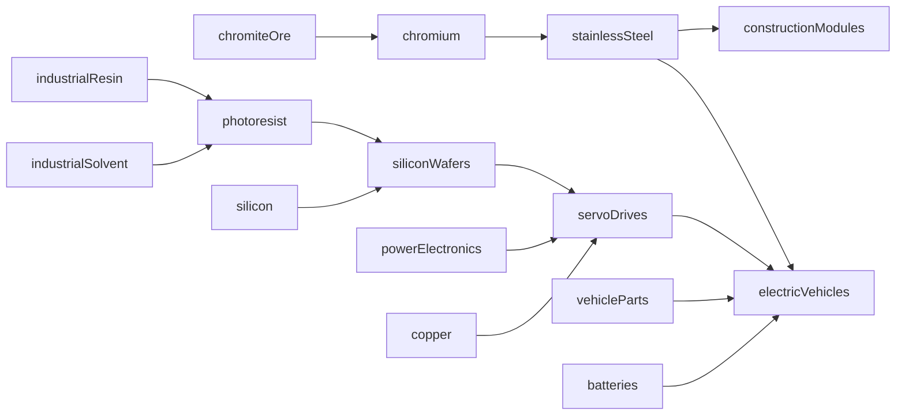

# Map Game 0.4.2 — Industrial Expansion, Phase 1

> Historical d62525e release record. Retained content is extended by [0.4.2A](042A_DESIGN.md); current totals/tests are in [0.4.2A validation](042A_VALIDATION.md).


Base: `feature/modern-frontier` at `bc8945d3deeb99d1074d341c1eccd11ad59a6d82`. New branch: `feature/0.4.2-industrial-expansion`. The 0.4.1 security-review commit is not an ancestor. No Supabase, authentication, ownership, server code or migrations are changed. Singleplayer only. No merge into main.

## Audit and scope

The gameplay baseline already contains 121 internal material IDs, 100 selected player-facing materials (10 initially unlocked), 120 industrial definitions plus five starter contracts, seven paid research nodes, six eras and 13 cosmetic advancements. Twenty-one internal materials remain excluded from normal selection. Phase B catalog availability flags describe foundation/future/definitions-only classes; the C1 progression engine already licenses selected later-era factories. It is not a blank economy.

This batch adds **six materials, eight factories, three research nodes and three cosmetic advancements**. Totals: **127 internal IDs, 106 player-facing materials, 128 industrial definitions plus five starter contracts, 10 research nodes and 16 advancement goals**. The initial 10 materials and all original definitions, recipes, prices, unlocks and goal records remain unchanged. No hundreds-entry expansion or full forest/economy rewrite.

## Connected production graph



The metallurgy branch supplies corrosion-resistant construction and transport. The chemical/wafer/servo branch supplies precision transport. Construction modules and electric vehicles reuse existing output IDs rather than creating duplicate final goods. Existing production paths stay available. Every new material has an actual producer and consuming recipe. There is no market sale price or new trade system; costs are purchase materials, upkeep and recipe inputs below.

## Balance table

Rates are per simulated minute offline; active Singleplayer multiplies both inputs and outputs by 1.2. Workers, power and upkeep retain existing rules and are not multiplied. Each site additionally costs **6 Steel, 2 Carbon, 12 Concrete and 6 Glass** to construct. Footprints and reusable visual IDs are in the canonical JSON and shop inspector.

| Factory | Era | Purchase money | Inputs / minute | Outputs / minute | Power | Workers | Money upkeep / minute |
| --- | ---: | ---: | --- | --- | ---: | ---: | ---: |
| Chromite Mine | 3 | 42000 | none | 12 chromiteOre | 4 | 4 | 5 |
| Chromium Refinery | 3 | 84000 | 12 chromiteOre, 3 industrialAcid | 6 chromium | 8 | 6 | 8 |
| Stainless Steel Works | 4 | 110000 | 6 steel, 3 chromium | 6 stainlessSteel | 8 | 6 | 8 |
| Photoresist Works | 4 | 145000 | 3 industrialResin, 3 industrialSolvent | 6 photoresist | 10 | 6 | 10 |
| Silicon Wafer Fab | 4 | 190000 | 6 silicon, 3 photoresist | 6 siliconWafers | 12 | 8 | 12 |
| Servo Drive Works | 5 | 240000 | 3 siliconWafers, 3 powerElectronics, 3 copper | 3 servoDrives | 12 | 8 | 12 |
| Corrosion-resistant Module Works | 4 | 135000 | 8 concrete, 2 stainlessSteel | 4 constructionModules | 6 | 4 | 6 |
| Precision Electric Transport Works | 6 | 320000 | 1 vehicleParts, 2 batteries, 1 servoDrives, 1 stainlessSteel | 1 electricVehicles | 10 | 6 | 10 |

Example steady-state capacity: one chromite mine supports one chromium refinery (acid supplied separately); that refinery can feed two stainless works. One photoresist works supports two wafer fabs; one wafer fab supports two servo works when copper/power electronics are supplied. One servo works can feed three precision transport factories, each also requiring batteries, vehicle parts and stainless steel. These are capacity ratios, not a promise of immediate same-tick operation: the solver consumes starting stocks, so new chains ramp progressively.

The alternate module works replaces beams/glass inputs with stainless steel, at higher purchase cost and upkeep. Precision Electric Transport keeps the existing 1 vehicle/minute output and 10 upkeep, adds servo/stainless supply investment and higher capital cost, and reduces power/workforce from the old assembly plant’s 12/8 to 10/6. This is a tradeoff, not a hidden output buff. Resources are abstract game units, not stoichiometric kilograms. No material or money may be created outside declared paid production.

## Research and unlocks

| New license | Earliest era | Prerequisites | Money cost |
| --- | ---: | --- | ---: |
| Advanced Metallurgy | 3 | miningRefining, constructionTechnology | 8000 |
| Precision Fabrication | 4 | advancedMetallurgy, electronicsFoundations | 12000 |
| Industrial Automation | 5 | precisionFabrication, industrialMachinery | 18000 |

Chromite/chromium unlock in era 3; stainless, photoresist and wafers in era 4; servo drives in era 5. The new vehicle site also requires the existing era-6 electric-vehicle unlock. Completing a license does not bypass material or era requirements. New factories retain their sector research requirements and add explicit `researchRequirements`. Paid research is exact and idempotent. The three new advancement goals recognize those actual license completions, add no money/resources and preserve all old goal IDs.

## Architecture and compatibility

- Sources: `catalog.json`, `player-materials.json`, `research.json`; deterministic browser mirrors generated by the existing build scripts. `balance.csv`, `dependency-graph.json` and `PRODUCTION_GRAPH.md` are refreshed from runtime data.
- Registry validates totals, IDs, aliases, recipes, amounts, models, storage classes, cycles and references once at load. Progression validates added license references/era bounds. Explicit new recipe and progression tests cover dependency reachability.
- Registry schema remains v1, progression v1 and economy/save schema v4: this is an additive compatible catalog release. Existing unknown fields, exact ledgers, inventories, pinned factory contracts, earned research and era are preserved. Newly recognized materials start at zero when absent. No repricing or repinning of old factories.
- Main-thread and worker import tags are updated together. The numerical solver is unchanged; no economy work is added to terrain/forest/pixel loops. Uncapped offline catch-up and existing budgeted worker processing remain intact.
- Shop/inventory/research use the existing UI. Dynamic discovery totals replace hard-coded 100; new factory inspectors show added license requirements. Advancements use existing snapshot events; graph height extends for added goals without moving old goals.
- Existing warehouse, steel-mill and chemical-plant models are reused. There are no new image assets or unsupported models. Warehouses/logistics networks, upgrade effects, new trade systems and multiplayer economy are not implemented.

## Reproduction

```sh
node industrial/build-data.cjs
node industrial/build-progression.cjs
node industrial/export-catalog.cjs
node --test tests/*.test.cjs
node tests/phase-c1-benchmark.cjs /tmp/mapgame042-benchmark
# With Playwright/Chromium and a local source server:
node tests/industrial-expansion-browser.cjs /tmp/mapgame042-browser
```

Browser test uses an explicit prepared legacy Singleplayer save to reach later eras, then actual paid UI research and all eight canvas purchases. It exercises a synthetic ten-minute offline reload, not ten minutes of physical waiting. Existing C1 and Modern Frontier tests retain their organic introductory flows. No actual user save is committed.

Older clients are not promised to understand new completed research IDs; keep a backup before trying an older release. See [validation and measured performance](042_VALIDATION.md). Live Babylon CDN loading remains an environment-dependent release check; explicitly substituted test libraries are never represented as deployed-site validation.
