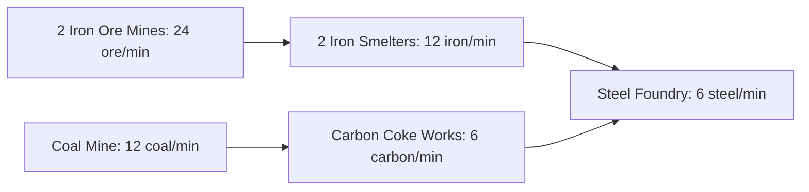

# Phase B — industrial catalog and supported chains

The implemented registry contains **120 industrial definitions and 121 materials** (120 goods plus Money). [catalog.json](catalog.json) is canonical; `build-data.cjs` generates its synchronous browser mirror. [catalog.schema.json](catalog.schema.json) and `registry.js` validate it. `integration.js` registers the entries with the existing building catalog and checks model references against the real renderer catalog.

- **56 industrial entries are playable**, in addition to the five existing starter contracts.
- **54 are future-locked**, with no research/unlock action supplied in this phase.
- **10 defense entries are definitions only**. They cannot be purchased or operate, even if a saved record names one.

[AVAILABILITY.md](AVAILABILITY.md) lists every ID by status and sector. [balance.csv](balance.csv) contains the full purchase, operating, input/output, era/technology, model and future-upgrade tables. The [interactive reference](catalog-reference.html) filters all entries and expands their upstream dependencies without accessing a game save. The complete [Mermaid graph](PRODUCTION_GRAPH.md) and [machine-readable graph](dependency-graph.json) are derived from the same data.

| Sector | Definitions | Playable | Future-locked | Definitions only |
| --- | ---: | ---: | ---: | ---: |
| Mining | 14 | 11 | 3 | 0 |
| Refining | 12 | 8 | 4 | 0 |
| Construction Materials | 12 | 11 | 1 | 0 |
| Chemicals | 14 | 12 | 2 | 0 |
| Electronics | 12 | 2 | 10 | 0 |
| Machinery | 12 | 5 | 7 | 0 |
| Vehicles | 12 | 2 | 10 | 0 |
| Aerospace | 10 | 0 | 10 | 0 |
| Consumer Goods | 12 | 5 | 7 | 0 |
| Defense Manufacturing | 10 | 0 | 0 | 10 |

Era 1–2 foundational technologies are licensed by the Phase B policy, not earned by a new research system. Every technology ID exists in a validated prerequisite DAG. Era 3–6 factories remain locked. The two playable Vehicles entries make chassis and tires, not drivable vehicles. Aerospace is entirely locked; defense has no equipment/unit/supply effects. There are no definition-only entries disguised as purchasable products.

## Data and validation

Each definition has a stable ID/name, sector, footprint, existing model ID, purchase costs, workers, electricity, upkeep, one fixed versioned recipe, intended era/technology, storage class/logistics metadata, styles, ten-level limit and four specialization names. All rates are per game minute. Recipes currently have one output each; there is no runtime recipe-selection UI.

The validator rejects duplicate material/building/recipe/technology IDs, ambiguous aliases, undefined materials, invalid/non-finite/negative or over-precision amounts, missing technology/model references, technology cycles, material dependency cycles, invalid metadata and unreachable playable input/construction-cost chains. Integration also rejects collisions with existing building IDs. It forbids industrial currency minting, and only paid extraction may have no material inputs. Every industrial entry requires positive workers, electricity and upkeep. All material recipe cycles are rejected, including potentially useful recycling: none is intentionally supported in this release.

Money, Steel, Carbon, Iron, Concrete and Glass keep their existing balances/IDs. Declared aliases resolve to those same balances; simultaneous aliases in a purchase cost are combined before checking/debiting. Other materials use the versioned inventory. Names and display order do not determine accounting slots.

## Active manufacturing examples

These chains can be constructed and operated now, subject to funds, energy, workers and material availability:

- Iron Ore → Iron; Coal → Carbon; Iron + Carbon → Steel.
- Copper Ore → Copper → Wire; Steel → Beams, Plates and Pipes.
- Limestone + Carbon → Cement; Cement + Silica → Concrete.
- Natural Gas → Industrial Gas; Silica + Industrial Gas → Glass.
- Crude Oil → Fuel; Fuel + Industrial Gas → Plastic.
- Fuel + Sulfur → Rubber; Fuel → Lubricant; industrial feedstocks → Resin, Solvents, Adhesive and Synthetic Textiles.
- Silica + Carbon → Silicon; Silicon + Industrial Gas → Semiconductors; Semiconductors + Copper + Plastic → Circuit Boards.
- Steel → Tools; Steel + Wire → Motors; Steel + Lubricant → Gears and Bearings; Steel + Pipes → Pumps.
- Beams + Plates → Chassis; Rubber + Wire → Tires.
- Plastic/Steel/Textiles → Household Goods/Furniture/Workwear; Polymer Film → Packaging; Lubricant + Adhesive → Industrial Consumables.

New manufactured materials also participate in construction: chemicals require Pipes; electronics require Wire; machinery requires Beams and Wire; vehicle-component factories require Motors and Steel Plates; consumer-goods factories require Plastic and Wire. Basic extractors/refineries can bootstrap using the existing initial Money/Steel/Carbon/Concrete/Glass supplies. Higher-tier construction requirements are retained as metadata for locked entries.

The original five starters deliberately keep their old rates and input-free starter contracts, including their existing feedstock abstraction. They remain accessible in the Starter category. This explicit compatibility exception is separate from the new industrial recipes; it is not presented as a fully rebalanced extraction economy.

### A balanced steel district

Base rates, before the visible-online multiplier:

| Quantity | Building | Inputs / minute | Outputs / minute | Workers | Power | Upkeep / minute |
| ---: | --- | --- | --- | ---: | ---: | ---: |
| 2 | Iron Ore Mine | None; paid extraction | 24 Iron Ore total | 4 | 4 | $6 |
| 1 | Coal Mine | None; paid extraction | 12 Coal | 2 | 2 | $3 |
| 2 | Iron Smelter | 24 Iron Ore total | 12 Iron total | 8 | 12 | $12 |
| 1 | Carbon Coke Works | 12 Coal | 6 Carbon | 4 | 6 | $6 |
| 1 | Steel Foundry | 12 Iron + 6 Carbon | 6 Steel | 4 | 6 | $6 |

The industrial portion uses **22 workers, 30 power and $33/min upkeep**. Three Residential Homes provide 60 housing (up to 36 workers), a Small Power Plant supplies 40 power, and one Commercial Store supplies $180/min base money. The complete 12-building district uses **26 workers, 36 power and $50/min upkeep**. At steady operation it earns net $130/min offline or $166/min online, and produces 6 or 7.2 Steel/min respectively. It must first grow residents, build feedstock buffers and satisfy upfront operating reserves. Houses/growth/capacity/upkeep do not receive the production boost.

The browser test first builds only one iron mine/smelter pair, observes iron starvation, then buys another pair and an extra home. Steel rises from 114 to about 226 after the additional offline interval and live buffer ramp-up; the foundry resumes full operation. This demonstrates a real shortage/capacity decision rather than crediting test goods directly.

## Accounting and current limits

Inputs are reserved from starting stocks; output from a tick cannot finance another input in that same tick. A shortage pauses the whole building and leaves its inputs/upkeep unspent. The online 1.2× speed applies proportionally to both inputs and outputs. Thus a balanced offline chain may briefly wait for a larger buffer when switching to online speed. Shortage details show the missing material and available/required tick quantity.

Exact BigInt accounting, ten-second rules, partial settlement, uncapped elapsed time, guarded cycle acceleration and workers remain. The inherited 10^12 stock ceiling still bounds stored amounts; it is not an offline-time cap or a warehouse network. Recipe quantities are abstract game units, not physical industrial instructions or a mass/energy model.

Material stocks are globally shared within Singleplayer. No transport throughput, warehouses, storage-class restrictions, routing, shipment delays, terrain deposits/depletion or market sales are simulated. Many final goods are inventories awaiting later construction/progression/market consumers. No research, upgrade/specialization effects, services, new roads/district effects, unit equipment, combat or multiplayer economy transactions were added. These are explicit C–F limits, not hidden unlocks.
