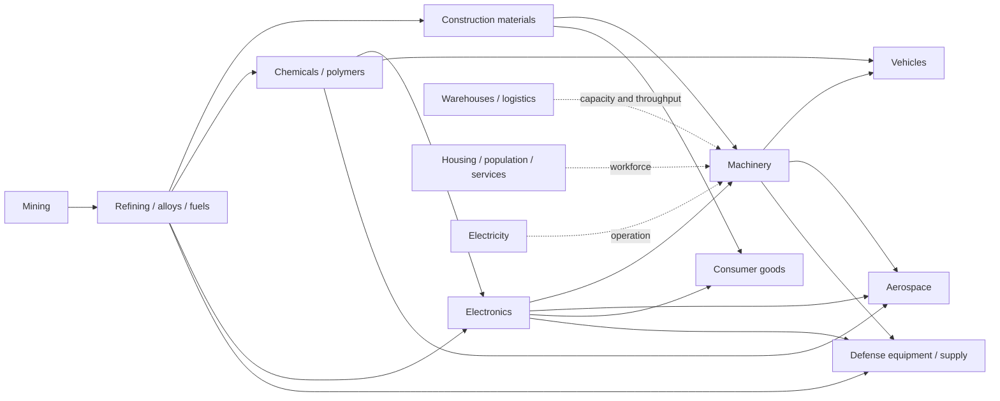

# 0.3.4 Industrial Revolution — phased contract

Integration branch: `feature/0.3.4-industrial-revolution`, from `feature/0.3.3d-economy` (8042c84). Phases A, B and C1 are implemented; see `PHASE_A_VALIDATION.md`, `PHASE_B_VALIDATION.md` and `PHASE_C1_VALIDATION.md`. Phase C1 follows the official roadmap amendment; C2–F remain future work. Stop after C1. Conditional PR merge is authorized only after every C1 release gate passes.

| Phase | Deliverable | Gate before advancing |
| --- | --- | --- |
| A | Uncapped offline computation, exact accounting, v2 migration, worker/cancellation and clock protection; baseline profiling and catalog contract | Deterministic/reference, persistence, browser/navigation, large-city and long-absence results |
| B | Material registry, 120 industrial definitions, validated recipes and production graph; grandfather existing recipes/balances | Recipe conservation/shortages, catalog references/cycles, migration, browser and performance comparison |
| C1 | Simplification, exactly 100 visible materials, six-era beginner progression, initial research, optional operating priorities and additive migration | Manifest/acquisition/DAG, compatibility, browser, performance and exact proposed merge validation |
| C2 | Warehouses, storage classes/capacity, transport throughput, city services and configurable operating priorities | Capacity/congestion/shortage and service thresholds; thousands-building UI/profile tests |
| D | Six eras, branching visual research tree, ten upgrade levels, four specializations, event-derived achievements/statistics | Unlock DAG, replay/idempotence, purchase/upgrade balance, save migration and UI tests |
| E | Architectural style selection, reusable existing models, Basic footprints, roads and industrial district connections | Placement/navigation/overlap, geographic compatibility, rendering and browser comparisons |
| F | Civilian-to-defense dependencies and equipment/supply inventory foundation; integrated release validation | Supply conservation, no unauthorized ownership/combat writes, all phase suites and full performance report |

## Official C1 roadmap amendment

C1 introduces accessible progression before the deeper systems. It does not replace C2–F. Research here is a small fixed-cost prerequisite tree; advanced research, upgrades and achievements remain D. All 121 internal materials and 125 economy definitions remain intact. A frozen explicit manifest selects 100 player-facing materials (10 initial plus 90 across six eras); excluded balances remain accessible through Legacy Inventory. No catalog prices or recipes change. Optional priority changes settle elapsed time first. Multiplayer rewards remain a disabled future interface. See `PHASE_C1_SPECIFICATION.md` for the approved contract.

Every phase supplies a change summary, balance tables, migration notes, screenshots and baseline comparisons. No automatic merge. Existing features remain accessible; replacing a feature requires an explicit documented migration. Multiplayer economy remains out of scope without a separate server-authoritative proposal. Military industry produces inventory, not uncontrolled multiplayer combat.

## Catalog contract for Phase B

`catalog.schema.json` is the implemented Phase B contract. The 120 definitions and versioned materials are in `catalog.json`, with runtime validation/integration in `registry.js` and `integration.js`. Availability is explicit: 56 playable, 54 future-locked and 10 definitions only; the five starter contracts remain available. IDs are stable; recipes reference material IDs rather than translated labels. Catalog validation must enforce unique IDs, existing material/model/technology references, nonnegative finite amounts, productive recipes, storage-class compatibility, and explicit handling of cycles. All rates are per game minute. The schema permits unknown fields for forward compatibility; semantic validation is required in addition to shape checks.

The 120-building industrial budget is:

| Sector | Definitions | Representative chain |
| --- | ---: | --- |
| Mining | 14 | Ore, coal, silica, mineral and feedstock extraction |
| Refining | 12 | Ore/concentrate → ingots, alloys and fuels |
| Construction materials | 12 | Limestone/silica/steel → concrete, glass, structural parts |
| Chemicals | 14 | Feedstocks → polymers, industrial gases, reagents and composites |
| Electronics | 12 | Silicon/metals/chemicals → circuits, sensors and control systems |
| Machinery | 12 | Steel/electronics → tools, engines and industrial machines |
| Vehicles | 12 | Machinery/rubber/electronics → civilian transport and components |
| Aerospace | 10 | Alloys/composites/precision electronics → aerospace assemblies |
| Consumer goods | 12 | Basic materials/components → household goods and commercial supply |
| Defense manufacturing | 10 | Civilian alloys/machinery/electronics → equipment and supply inventory |
| **Industrial total** | **120** | Housing, utilities, warehouses and services are additional |

Proposed storage classes: bulk, liquid, general, precision, hazardous. Phase B adds a versioned inventory registry while retaining Money/Steel/Carbon aliases and prominent display. Phase C supplies actual warehouse/network capacity; Phase A's existing 10^12 numeric resource ceiling is not a warehouse simulation.

Each building references an existing renderer/model identity and configurable footprint, purchase costs, operating power/workers/upkeep, recipe, era/technology, logistics properties and styles. Definitions support ten upgrade levels and Production, Efficiency, Automation and Logistics specialization metadata. Upgrade effects, costs and unlocks are not activated until Phase D; avoid silently reinterpreting existing building levels.

## Production graph

The active Phase A graph is unchanged: housing + power → workers; workers + power + upkeep → starter steel, carbon and commercial money. Starter contracts deliberately retain their implicit feedstock for compatibility. The new Phase B industrial entries consume explicit input/output recipes, without changing those five starter contracts.

The following graph describes catalog dependencies. Early industrial chains are active in Phase B; later-era and defense nodes remain locked/inactive. Consult `AVAILABILITY.md` for exact status:

Outputs of a tick cannot finance inputs of that same tick. Online speed consumes proportionally more inputs as well as producing more outputs; upkeep and capacity are not boosted. Phase A tests this rule with prototype recipes over the six existing resources, without changing the five starter recipes; the Phase B catalog now supplies explicit industrial recipes. Storage overflow/blocked outputs and logistics will need explicit Phase B/C policies rather than assuming goods teleport indefinitely.

## City and progression contract

Housing remains required for growth; electricity and workforce gate factories. Services in C will have explicit population thresholds, capacities and operating costs. Priority changes must settle elapsed time before mutation and be persisted as events; stable saved order remains the Phase A fallback.

The six planned eras are Settlement, Industrialization, Electrification, Mass Production, Information Age and Global Superpower. Research is a branching DAG with explicit prerequisite IDs. Transactions for construction, recipe selection, upgrades and research must be idempotent and settle old-state time before applying their changes. Achievements should derive from committed Singleplayer events, with unique event IDs and no re-award on reload. These local events do not establish multiplayer authority or anti-cheat security.

## Phase A balance table (active and unchanged)

| Existing ID | Purchase | Power use / supply | Workers | Base output/min | Upkeep/min |
| --- | --- | --- | ---: | --- | ---: |
| smallHouse | $12,000 + 2 steel | 1 / 0 | 0 | 20 housing; 2 growth when powered | $1 |
| powerPlant | $25,000 + 10 steel + 5 carbon | 0 / 40 | 0 | Power capacity | $6 |
| steelMill | $45,000 + 15 steel + 5 carbon | 10 / 0 | 6 | 6 steel | $12 |
| carbonPlant | $35,000 + 10 steel | 8 / 0 | 4 | 4 carbon | $10 |
| cornerStore | $18,000 + 4 steel | 3 / 0 | 4 | $180 | $8 |

Visible online production stays 1.2×, offline production 1× with **no elapsed-time cap**. Housing, growth, energy/workforce capacities and upkeep remain unboosted. Fresh balances remain $400,000, 100 steel and 40 carbon. Existing footprint, terrain/water checks, styles/models, legacy income definitions and world coordinates remain unchanged.
