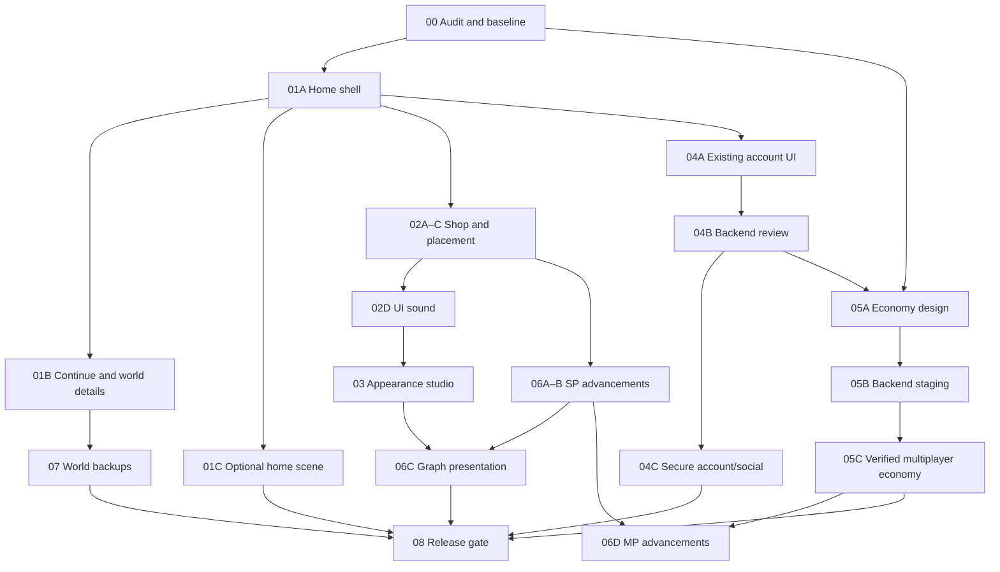

# Modern Frontier — checkpoint roadmap

Source contract: [SPECIFICATION.md](SPECIFICATION.md). Base: validated visual restoration `9111c239971fea1a27d11756490593b5cce63b43`, including industrial `dfbe4ff66eb5f69179562fa577a156b44dbb424a`. Integration branch: `feature/modern-frontier`. Main is not the base.

## Working agreement

User steering: complete the update in one turn, using bounded updates → checks → integration on the feature branch without pausing between milestones. Report the combined result at the end. Each checkpoint has its own commit and evidence. “Blend” means integration into this feature branch, never an automatic merge to main. Do not batch several major phases into a single unreviewable change. Stop on a failed gate; fix that checkpoint before moving forward. Keep working systems available throughout.

Checkpoint 00 was completed in the previous delivery. The current delivery integrates the frontend milestones together with explicit validation checkpoints; backend-dependent operations remain blocked pending real deployment/security evidence. Checkpoint 00 itself changed no runtime features.

## Current status

| Area | Verified source status | Roadmap status |
|---|---|---|
| Geography/biomes/forests/drainage | Shared deterministic terrain, progressive caches, normal-zoom restoration | Preserve |
| Industrial A | Uncapped elapsed time, exact ledger, constrained simulation | Implemented; preserve |
| Industrial B | 121 canonical resources, 120 industrial definitions, aliases/recipes | Implemented; preserve |
| Industrial C1 | 100 visible resources, 10 initial, six eras, seven research nodes | Implemented; preserve |
| Five starter contracts | Existing costs, production and placement | Implemented; preserve |
| Visual restoration | Compact resources, side shop, research links, themes/density | Validated feature branch; not main/deployed |
| Central World | Authentication, membership/presence, territory/capital persistence | Existing; backend security not independently verified |
| New home/shop/studio | Integrated in Modern Frontier; current release tests tracked in VALIDATION.md | Implemented on feature branch |
| Social/username cooldown/deletion | No complete implementation or backend policy in repository | Backend-dependent |
| Multiplayer economy | Deliberately Singleplayer-only today | Blocked until authoritative backend verification |
| Advancements and backups | 13 cosmetic SP objectives, three pins, full slot export/import/recovery | Implemented on feature branch |
| C2 warehouse simulation / D upgrades / combat | Not implemented | Remain future, no implicit activation |

## Small implementation checkpoints

Every row includes its dependencies and a gate. Tests of affected behavior run per checkpoint; full release suites run at major UI integrations and before any release. All runtime checkpoints repeat relevant gameplay, save and error checks.

| ID | Bounded update | Dependency | Check before blending |
|---|---|---|---|
| 00 | Repository/asset/economy/security audit, plan and baseline evidence | Validated restoration | Fresh deterministic suite; protected runtime diff empty |
| 01A | Home structure: two play cards, existing launch/auth wiring, truthful feature/update content | 00 | Home ready, Singleplayer entry, signed-out Central gating, settings lifetime, responsive keyboard checks |
| 01B | Read-only world summary and Continue; deliberate New World flow design and backup requirement | 01A | Corrupt/newer saves retained; no writes on view; cancel/reload; no silent world reset |
| 01C | Asset-backed home scenery, optional motion/static fallback and real/preview feature links | 01A | No blocked interaction; reduced motion; no GPU/render loop leak after launch; matched screenshots/performance |
| 02A | Near-full-screen shop shell; supported categories; search/filter/sort/favorites preferences | 01A | Existing purchase and placement API retained; camera/focus/reopen at all three sizes |
| 02B | Actual-catalog cards and detailed recipe/affordability/preview inspector | 02A | All 125 definitions represented truthfully; 1.2× throughput/input display; locked and legacy states |
| 02C | Placement integration and disabled upgrade foundation | 02B | Atomic payment, terrain/collision/rotation/cancel/failure/reload; no fake upgrades; Central spending stays disabled |
| 02D | Opt-in gesture-started UI synthesis and volume controls | 02C | Silent boot/hover; mute, context resume, throttling and accessible feedback |
| 03A | Unified appearance tokens, presets, typography/density, motion/graphics/audio settings | 02D | Persistence outside world saves; contrast/focus/text scaling; old preferences retained |
| 03B | Local image backgrounds: bounded decode, crop/dim/reset and storage failure handling | 03A | Reject unsupported/oversized images; no public uploads/unsafe CSS/scripts; privacy and quota checks |
| 04A | Account/social UI using existing capabilities; explicit noninteractive unavailable previews | 01A,03A | No invented presence; no unauthorized personal-data requests; signed-out/expired-session checks |
| 04B | Reviewed username/delete/social backend contract and threat model | 04A | Verify actual schema/RLS/RPC and deployment authority; define retention, reports/moderation and rollback |
| 04C | Implement only backend-proven account/social operations | 04B | Case-insensitive uniqueness, concurrent 2h cooldown, deletion confirmation/reauth; cross-user and spam tests |
| 05A | Multiplayer authoritative catalog/account/world/placement/settlement specification and isolated tests | 00,04B | Permission matrix, trusted time, balance scope, authoritative terrain/collisions, idempotency and concurrency design |
| 05B | Versioned backend migrations/RPC/settlement implementation in isolated staging | 05A | Deployment access and reviewed migration; adversarial atomicity/RLS tests; no live migration by assumption |
| 05C | Client integration behind unavailable-by-default capability gate | 05B | Real authenticated two-user end-to-end tests; no SP gate bypass; retries/concurrency/clock abuse |
| 06A | Curated advancement graph and read-only event/state contract, separate from research | 02C | Only provable existing events; deterministic DAG/prerequisites; no invented rewards/currency |
| 06B | World-specific SP idempotent progress, up to three pinned goals and persistence | 06A | Explicit additive schema/migration review before writes; duplicate/reload/import/corrupt-save tests; no inferred unearned rewards |
| 06C | Full-screen pan/zoom graph, evolving visual detail, optional animated links/backgrounds | 06B,03B | Keyboard navigation, culling/LOD/reduced motion, readable layout; completion logic unaffected |
| 06D | Verified multiplayer advancement synchronization, if backend ready | 05C,06B | Server events/reward-once semantics; no client-authoritative rewards |
| 07A | World Manager: details, status and private export of complete compatible snapshot | 01B | Include world, economy, seed and unknown fields; no credentials/tokens; consistent paused snapshot |
| 07B | Validated import, pre-import backup and matching-snapshot restore | 07A | Bounded parse/schema validation, unknown fields, rollback on storage failure, cross-tab exclusion; no schema-number downgrade |
| 08 | Integrated accessibility/performance/security release candidate | All applicable implemented checkpoints | Full gate below, deployed browser checks separately; unresolved systems remain explicitly unavailable |

Phase dependencies are not permission to skip checkpoints. UI-only work can proceed independently while backend access is blocked. Phase 01B may expose New World as unavailable until a tested backup/reset transaction exists; never clear the only local save to satisfy a visual mockup. Phase 07 backup primitives may be brought forward as a separately reported checkpoint if required by New World. Full offline-capable play is a separate service-worker/cache implementation and browser gate, not an assumed browser-cache property.

## Dependency graph

## Common validation and release gate

- Deterministic suite: `node --test tests/*.test.cjs`. Exact BigInt accounting, no elapsed-time cap, proportional boosted inputs/outputs, shortages, migration/unknown fields, pinned contracts and tree/terrain fingerprints must remain green.
- Inherited browser release: `NODE_PATH=/workspace/.onboarding-tools/node_modules MAP_GAME_TEST_URL=http://127.0.0.1:8001 node tests/run-visual-release.cjs <artifact-directory>`. Requires a source server, installed Chromium/Playwright and the existing verified TLS trust. Never bypass TLS. Preserve its historical baseline gate; add separate comparisons to `9111c23` for this update rather than silently replacing old baselines.
- Add focused browser coverage for each new checkpoint. Test 1366×768, 1440×900 and 1920×1080, focus/keyboard/Escape, reduced motion, text scaling and real UI clicks. No arbitrary screenshot passed off as deployed validation.
- Recheck Singleplayer, World Map, territory entry/return, repeated zoom/pan, tree/water/texture availability, shop reopen, placement/rotation/cancel, research, all inventory selections, and save/reload. Verify 3D remains paused in Basic mode.
- Compare startup/entry, FPS, p95/max frame intervals, long tasks, memory methodology and 100/1,000/10,000-building cities against matched baseline fixtures. Warm up identically; use repeated interleaved samples and report variability. Investigate regressions, do not hide spikes or reduce simulated work.
- No new page/console errors or failed required assets. No secrets/credentials, unrelated artifacts or unreviewed ownership changes in commits.
- Multiplayer release requires real deployed authorization and adversarial tests for cross-user reads/writes, free factories, unlock bypass, duplicate debit, overlapping placements, clock abuse and settlement concurrency. Frontend tests/mocks cannot establish database security.
- Main stays unchanged until the complete applicable prior release gates, current performance review, security/deployment checks and exact proposed-merge tests pass. Do not auto-merge any checkpoint. Report backend-blocked features separately; never describe them as released.

## Checkpoint records

| Checkpoint | Result | Evidence |
|---|---|---|
| 00 | Complete: documentation only, 91/91 fresh tests passed | [Audit](AUDIT.md), [checkpoint record](CHECKPOINT_00.md) |
| 01A–C | Implemented | Asset-backed home, existing launch/auth gating, truthful updates, continue/details; backed-up New World |
| 02A–D | Implemented; gated by regression suite | Full-screen paged catalog, real inspector, favorites/sort, existing placement, opt-in UI tones; upgrades unavailable |
| 03A–B | Implemented | Five presets, appearance/motion/volume, validated local-only backgrounds |
| 04A | Implemented | Existing account status with unavailable social/rename/delete previews |
| 04B / 05A | Design/audit delivered | [Backend contract and unrun adversarial release matrix](SECURITY.md) |
| 04C / 05B–C / 06D | Blocked, unavailable | No admin interface/deployed schema/RLS/settlement verification; no client substitute |
| 06A–C | Implemented | World-specific cosmetic SP objectives, progressive graph reveal, pan/zoom and three pins |
| 07A–B | Implemented | Exact-string backup, import/restore/New World confirmation, writer lock and rollback journal |
| 08 | Functional validation passed; release blocked | [101 tests, browser flows, measurements and open performance/backend gates](VALIDATION.md); main unchanged |

Future checkpoint reports must list files, tested commit, automated/browser results, before/after screenshots where relevant, performance, compatibility, limitations and next bounded update.
